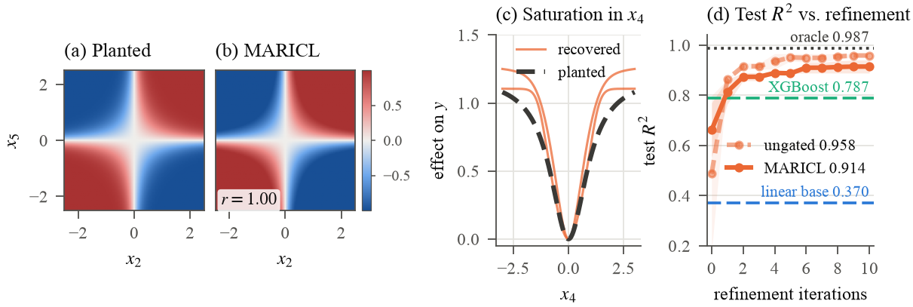

<h1 align="center">MARICL</h1>

<p align="center">
  <b>Multi-Agent Residual In-Context Learning</b><br>
  Ask the LLM to debug a model rather than be one.
</p>

<p align="center">
  <a href="https://arxiv.org/abs/2605.22897"></a>
  <a href="LICENSE"></a>
  <a href="#a-function-no-llm-has-seen"></a>
</p>

<p align="center">
  <a href="#a-function-no-llm-has-seen">Example</a> ·
  <a href="#what-the-paper-found">Findings</a> ·
  <a href="#how-it-works">How it works</a> ·
  <a href="#quickstart">Quickstart</a> ·
  <a href="#citation">Citation</a>
</p>

When software fails, we read the error, form a hypothesis, write a patch, and test it. When a tabular model fails, we usually retune it.

MARICL gives that debugging step to an LLM. Agents read a base model's worst errors, write down what it is missing as an executable formula, and rewrite that formula wherever it still fails. The result is a readable correction that runs with no LLM calls at inference.

This is the code for [*From Residuals to Reasons: LLM-Guided Mechanism Hypotheses from Tabular Data*](https://arxiv.org/abs/2605.22897).

<details>
<summary><b>Abstract</b></summary>

> When software fails, we read the error, form a hypothesis, write a patch, and test it. When a tabular model fails, we usually retune it. Most interpretability methods report which features matter rather than how they combine. Asking an LLM to predict the target directly forces it to search the whole output space; instead, we anchor the prediction with a base model and ask the LLM to debug it. We introduce **Multi-Agent Residual In-Context Learning (MARICL)**, in which LLM agents read high-residual examples, hypothesize the missing structure, and write executable correction terms that are then refined by multi-turn textual gradient optimization. The resulting corrections are readable, executable hypotheses about what the base model misses, rather than validated mechanisms. Across nine benchmarks covering scientific, biomedical, socioeconomic, and synthetic data, MARICL reliably repairs its base model's structured residuals, improving it on every dataset, and it recovers the form of both nonlinear terms planted in a function absent from pretraining data (two seeds). Against the strongest competing baseline it leads on five of the eight real benchmarks and trails TabPFN on the other three, while adding an inspectable correction that black-box baselines do not provide.

</details>

## A function no LLM has seen

An LLM that improves a protein-yield model may simply remember its biochemistry. To separate reasoning from recall, we planted a function that cannot appear in pretraining data, and told Claude Opus 5.5 only that the features have unknown meaning:

$$y = 0.4\,x_1 - 0.3\,x_3 + 2\,\sigma(3\,x_2 x_5) + 1.2\,\frac{x_4^2}{1+x_4^2} + \varepsilon$$

Both nonlinear terms are uncorrelated with every individual feature, so a linear base model sees almost none of them. Feature `x6` is irrelevant.



<sub>(a) The planted interaction. (b) MARICL's correction on the same scale. (c) The planted `x4` effect and the correction recovered on each seed. (d) Test R² as refinement proceeds.</sub>

| Test R² | Seed 0 | Seed 1 | Mean |
|:---|---:|---:|---:|
| Linear base | 0.347 | 0.392 | 0.370 |
| XGBoost | 0.833 | 0.741 | 0.787 |
| **MARICL** | **0.940** | **0.888** | **0.914** |
| MARICL, ungated | 0.952 | 0.965 | 0.958 |
| Oracle (noise-free) | 0.986 | 0.987 | 0.987 |

Claude wrote this correction on seed 0:

```python
clip(0.25 * x4**2 / (0.5 + x4**2) - 0.115 + 0.25 * tanh(1.5 * x2 * x5), -0.6, 0.6)
```

`tanh(1.5 * x2 * x5)` is the planted interaction's shape exactly, because $2\,\sigma(3u) = 1 + \tanh(1.5u)$. All four retained corrections contain both planted nonlinear terms as explicit components, and none uses `x6`.

**Replay it with no API key.** Every prompt and answer is recorded, so this reproduces the results above exactly:

```bash
cd examples/synthetic_claude
pip install -r requirements.txt
python agent_step.py --seed 0
python agent_step.py --seed 1
```

**Limits.** Only two of the five seeds started finished, the forms come back more faithfully than the constants, and Claude answered through Claude Code agent sessions rather than stateless API calls. The [example README](examples/synthetic_claude/README.md) has the full protocol and shows how to run it with your own Anthropic credentials.

## What the paper found

- **It repairs the base model.** MARICL improves its base on all nine benchmarks. On cell-free protein yield, an LLM predicting directly reaches R² = 0.35, and the same LLM debugging a linear model reaches 0.65.
- **It is not the strongest predictor.** MARICL leads the strongest baseline on five of the eight real benchmarks and trails TabPFN on the other three. After BH correction at FDR 0.05, none of the five leads is significant. What it adds is an inspectable correction.
- **Much of the gain comes from the data.** With anonymized features, no domain context, and a smaller open model, roughly half of the gain survives.
- **Frozen formulas travel within a protocol, not across one.** Moved to new plates with no LLM calls, they improve the base on 95.3% of same-reagent pairs, against 62.1% for PySR-on-residuals and 57.7% for EBM. Across reagent regimes that falls to 2.7%, where those learners do better (13.5% and 17.4%).
- **Fluent is not the same as correct.** On scrambled reagent labels, MARICL can still write an equally fluent biochemical story. Two blinded raters flagged 80 of 100 such corrections, so readers can catch this, but it is why we call the outputs hypotheses.

## How it works

1. **Anchor.** A base model (linear regression, XGBoost, or any validated predictor) handles the regression, and its residuals show where it fails.
2. **Read.** Encoder agents read the high-residual examples and state what the model is missing as a structured hypothesis.
3. **Write.** Decoder agents compile each hypothesis into a natural-language explanation and a sandboxed Python formula.
4. **Refine.** An LLM critiques each formula on the examples where it still fails and proposes a rewrite. This is textual gradient optimization. The term is an analogy, and no derivative is computed.
5. **Freeze.** Corrections are combined with query-dependent weights and an outer gate. From here on, only arithmetic and nearest-neighbour lookups run, with **zero LLM calls**.

For regression, the prediction is

$$\hat{y}_{\text{MARICL}}(\mathbf{x}) = f_{\text{ML}}(\mathbf{x}) + \lambda(\mathbf{x}) \sum_{k=1}^{K} \alpha_k(\mathbf{x})\, f_k(\mathbf{x})$$

The weights $\alpha_k(\mathbf{x})$ decide which correction dominates at $\mathbf{x}$. The outer gate $\lambda(\mathbf{x}) \in [0,1]$ shrinks the summed correction, more strongly when no correction is both high-quality and close to the high-residual pool.

Corrections are readable, executable hypotheses, not validated mechanisms. They are selected by residual-prediction performance and read against the literature afterwards, so they need expert review before use in a new domain.

The paper's [pipeline figure](MA_RICL_Discovery_V2/Figures/figure1_maricl_schematic_v2.png) shows these steps in full.

## Quickstart

### Run the demo notebook

Install the dependencies:

```bash
pip install langchain langchain-openai openai pydantic numpy scikit-learn matplotlib python-dotenv
```

Create a `.env` file in the project root. The notebook also accepts `API_KEY` as an alias. **Do not commit this file.**

```
OPENAI_API_KEY=sk-...
```

Then open [`maricl_demo_v1.ipynb`](maricl_demo_v1.ipynb) and run the cells in order. It needs no external data. Expect OpenAI API charges, and results vary slightly because the temperature is nonzero.

| Variable | Default | Description |
|---|---|---|
| `MAICL_MODEL_NAME` | `gpt-5.4-mini` | Model passed to LangChain/OpenAI |
| `OPENAI_REASONING_EFFORT` | `low` | Reasoning effort for GPT-5 family (`none` to disable) |

<details>
<summary><b>What the notebook runs</b></summary>

**Experiment 1: synthetic regression.** A linear base model is fit on a 4-feature dataset whose true generating process contains structure it cannot capture:

$$y = 0.5\,x_1 - 0.3\,x_2 + 0.2\,x_3 + 1.8\cdot\sigma(2\,x_1 x_2) + 0.4\,x_3^2 + \varepsilon, \quad \varepsilon \sim \mathcal{N}(0, 0.1)$$

The linear model fits only the first three linear terms, so the sigmoid interaction ($x_1 \times x_2$) and the quadratic term ($x_3^2$) become residual signal.

Setup: 300 samples · 60/20/20 train/val/test split · `K=2` agents · `T=8` refinement steps

**Experiment 2: synthetic 3-class classification.** A logistic regression base model is fit on a 4-feature dataset with a nonlinear decision boundary:

$$\text{class} = \begin{cases} 0 & x_1 x_2 < -0.5 \\ 2 & x_1 x_2 > +0.5 \\ 1 & \text{otherwise} \end{cases} \quad \text{(with } 0.5\,(x_3^2 - 1) \text{ perturbation and 2\% label noise)}$$

A logistic model captures only marginal effects and misses the interaction boundary.

Setup: 500 samples · 60/20/20 split · `K=3` agents · `T=8` refinement steps · `beta=0.3` · `kappa=0.4`

</details>

### Use MARICL on your own regression task

Scale the target to [0, 1], fit a base model, and pass in LangChain chat models:

```python
import maricl_core as mc
from maricl_headline import maricl_predict, select

mc.configure_llms(llm, llm_creative)
model = mc.MARICL(task="regression", K=2, kappa=0.3, T=10, tau_fail=0.1)
model.fit(X_train, y_train, base_model=base, feature_names=names,
          feature_descs=descs, domain_context="What this data is about")

chosen, scores, _ = select(model, X_train, y_train, X_val, y_val,
                           base.predict(X_train), base.predict(X_val))
y_hat = maricl_predict(model, X_test, base.predict(X_test), chosen, scores)
```

`select` and `maricl_predict` add the paper's headline configuration: validation selection of the retained iterate and the outer gate. They support regression only and make no LLM calls. `MARICL.predict` on its own applies the ungated rule and keeps the iterate with the lowest training loss.

## Repository layout

```
.
├── maricl_core.py            # Framework: sandbox, models, prompts, pipeline
├── maricl_headline.py        # Headline configuration: validation selection and outer gate
├── maricl_demo_v1.ipynb      # Demo notebook (self-contained copy of the pipeline)
├── examples/
│   └── synthetic_claude/     # Planted-ground-truth benchmark with Claude (replays offline)
├── MA_RICL_Discovery_V2/
│   └── Figures/              # Paper figures
└── LICENSE
```

## Citation

```bibtex
@article{rezaei2026residuals,
  title={From Residuals to Reasons: LLM-Guided Mechanism Hypotheses from Tabular Data},
  author={Rezaei, Mohammad R and Krishnan, Rahul G},
  journal={arXiv preprint arXiv:2605.22897},
  year={2026}
}
```

arXiv v1 appeared under the earlier title *LLM-Guided Mechanism Inference from Tabular Data*.

## License

MIT. See [LICENSE](LICENSE).
