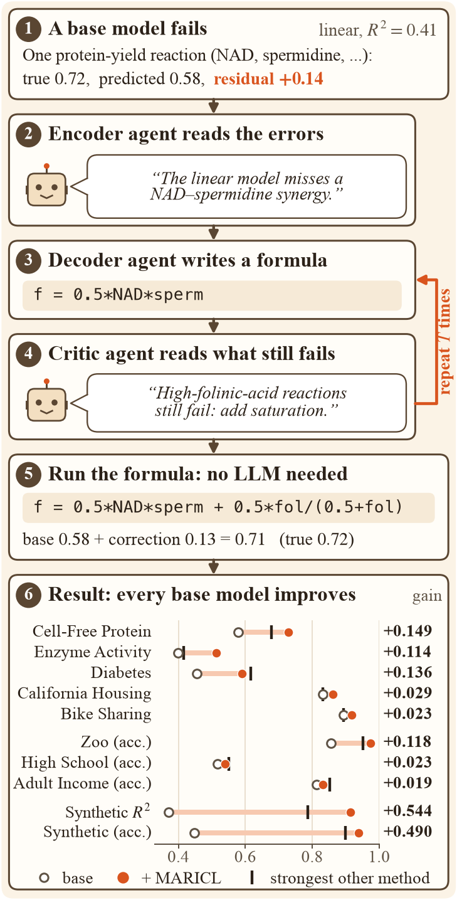

<h1 align="center">MARICL</h1>

<p align="center">
  <b>Multi-Agent Residual In-Context Learning</b><br>
  Ask the LLM to debug a model rather than be one.
</p>

<p align="center">
  <a href="https://arxiv.org/abs/2605.22897"></a>
  <a href="LICENSE"></a>
  <a href="examples/synthetic_data"></a>
</p>

When software fails, we read the error, form a hypothesis, write a patch, and test it. When a tabular model fails, we usually retune it. MARICL does the first thing instead: a base model makes mistakes, LLM agents read the high-residual examples, and they write a readable, executable formula that fixes them. At prediction time only the formula runs, with no LLM calls.

Code for [*From Residuals to Reasons: LLM-Guided Mechanism Hypotheses from Tabular Data*](https://arxiv.org/abs/2605.22897).

<p align="center">
  <br>
  <sub><b>Figure 1.</b> MARICL's loop on a running example (steps 1 to 5; K agents run in parallel) and its results (step 6): test R², or accuracy where marked, of the MARICL variant against its base model. Means over 5 seeds (synthetic: two). MARICL leads the strongest other method on five of the eight real benchmarks, none significantly after BH correction. <a href="figures/headline_results.pdf">PDF</a></sub>
</p>

## Results on synthetic data

Claude Opus 5.5 fixes the residuals of a linear model (regression) and a logistic model (classification). It is told nothing about the data.


| | Base model | XGBoost | **MARICL** | Best possible |
|---|---:|---:|---:|---:|
| Regression, test R² | 0.370 | 0.787 | **0.914** | 0.987 |
| Classification, test accuracy | 0.448 | 0.900 | **0.938** | 0.990 |

Means over two seeds. Both examples replay with no API key:

```bash
cd examples/synthetic_data
pip install -r requirements.txt
python agent_step.py --task regression --seed 0
python agent_step.py --task classification --seed 0
```

The [examples README](examples/synthetic_data/README.md) shows the formulas Claude wrote.

## How it works

1. **Fit** a base model, such as linear regression or XGBoost.
2. **Read.** LLM agents look at the examples with the largest errors and say what the model is missing.
3. **Write.** Each idea becomes a sandboxed Python formula.
4. **Refine.** The LLM critiques each formula where it still fails and rewrites it.
5. **Predict** with the base model plus the weighted formulas. No LLM is called.

$$\hat{y}(\mathbf{x}) = f_{\text{ML}}(\mathbf{x}) + \lambda(\mathbf{x}) \sum_{k} \alpha_k(\mathbf{x})\, f_k(\mathbf{x})$$

The formulas are readable, executable hypotheses, not validated mechanisms. Check them with a domain expert before relying on them.

## Use it on your data

Pass in LangChain-style chat models, or the Claude adapter in [`examples/synthetic_data/claude_backend.py`](examples/synthetic_data/claude_backend.py).

**Regression** (scale the target to [0, 1]):

```python
import maricl_core as mc
from maricl_headline import select, maricl_predict

mc.configure_llms(llm, llm_creative)
model = mc.MARICL(task="regression", K=2, kappa=0.3, T=10, tau_fail=0.1)
model.fit(X_train, y_train, base_model=base, feature_names=names,
          feature_descs=descs, domain_context="What this data is about")

chosen, scores, _ = select(model, X_train, y_train, X_val, y_val,
                           base.predict(X_train), base.predict(X_val))
y_hat = maricl_predict(model, X_test, base.predict(X_test), chosen, scores)
```

**Classification** (integer labels 0 to C−1):

```python
from maricl_headline import select_classification, select_beta, maricl_predict_proba

model = mc.MARICL(task="classification", K=2, kappa=0.3, T=10)
model.fit(X_train, y_train, base_model=base, feature_names=names,
          feature_descs=descs, domain_context="What this data is about", n_classes=C)

P_tr, P_va, P_te = (base.predict_proba(X) for X in (X_train, X_val, X_test))
chosen, scores, _ = select_classification(model, X_train, y_train, X_val, y_val, P_tr, P_va)
beta = select_beta(model, X_val, y_val, P_va, chosen, scores)
proba = maricl_predict_proba(model, X_test, P_te, chosen, scores, beta)
```

The `maricl_headline` functions pick the best refinement step on validation data, as in the paper, and make no LLM calls.

## What the paper found

- MARICL improves its base model on **all nine** benchmarks.
- It leads the strongest baseline on **five of eight** real benchmarks and trails TabPFN on the other three. After correction for multiple comparisons, none of the leads is significant.
- About **half** of the gain survives with anonymized features, no domain context, and a small open model.
- Fluent is not correct: with scrambled feature names, MARICL can still tell a convincing but wrong story.

## Abstract

> When software fails, we read the error, form a hypothesis, write a patch, and test it. LLMs now do this for neural networks by editing weights ([Takehi et al., 2026](https://rikiyat.github.io/blog/weight-space-programming/)); when a tabular model fails, we usually retune it. Most interpretability methods report which features matter rather than how they combine. Rather than asking an LLM to predict the target over the whole output space, we anchor the prediction with a base model and ask the LLM to debug it. We introduce **Multi-Agent Residual In-Context Learning (MARICL)**, in which LLM agents read high-residual examples, hypothesize the missing structure, and write executable correction terms that are then refined by multi-turn textual gradient optimization. The resulting corrections are readable, executable hypotheses about what the base model misses, rather than validated mechanisms. Across nine benchmarks covering scientific, biomedical, socioeconomic, and synthetic data, MARICL reliably repairs its base model's structured residuals, improving it on every dataset, and on synthetic data absent from pretraining it recovers the hidden structure (two seeds). Against the strongest competing baseline it leads on five of the eight real benchmarks and trails TabPFN on the other three, while adding an inspectable correction that black-box baselines do not provide.

## Related work: weight-space programming

[*Sparks of Weight-Space Programming*](https://rikiyat.github.io/blog/weight-space-programming/) (Takehi, Teoh, Zhang and Khattab, November 2026) shows that a general-purpose LLM can read a neural network's raw weights, guided by a natural-language spec, and write new weight values directly, with no optimizer. Their examples include fixing a reinforcement-learning policy by editing a small fraction of its weights and improving a small language model on math benchmarks. This is the closest published relative of MARICL's "LLM as debugger" idea, and it motivated the framing in our abstract. It is a blog post, not peer-reviewed work, and we have not run the two methods against each other: they solve different problems.

| | Weight-space programming | **MARICL** |
|---|---|---|
| What the LLM reads | The network's raw weights as text | The base model's largest errors (residuals) on the data |
| What the LLM writes | New numbers inside the network | A named, executable formula over the input features |
| Works on | Neural networks whose weights fit in context | Any base model that outputs predictions: linear, XGBoost, neural, or a black box |
| Base model | Edited in place | Left untouched; the correction is added on top and can be removed |
| What you can audit | The edit is a set of changed weight values | The edit is a formula such as `0.5*NAD*sperm` that a domain expert can read, test and reject |
| At prediction time | The edited network | Base model plus formula, with no LLM calls |
| Checked by | Task benchmarks | A held-out validation split, 5 seeds, and a multiple-comparison correction |

Where MARICL differs, and why it can be the better fit for tabular work:

- **It does not need weights.** Gradient-boosted trees, linear models and proprietary predictors have no weight vector for an LLM to program. The residual exists for every model, so MARICL applies to all of them.
- **The output can be read and argued with.** A formula over named features is a hypothesis about what the base model misses. A changed block of weights is not.
- **The base model stays intact and the LLM is not in the serving path.** The correction is a small, separable term, so it is cheap to run and easy to switch off.
- **The gain is gated.** A refinement step is kept only if it helps on validation data, and the paper reports where it does not help: no lead over the strongest baseline survives correction for multiple comparisons, and MARICL trails TabPFN on three of the eight real benchmarks.

Where weight-space programming goes further: it changes what a network computes internally, covers reinforcement-learning policies and language models, and needs no base predictions at all. The two approaches are complementary. MARICL's corrections are readable hypotheses, not validated mechanisms.

<details>
<summary><b>Demo notebook (OpenAI)</b></summary>

[`maricl_demo_v1.ipynb`](maricl_demo_v1.ipynb) runs a small regression and classification demo with an OpenAI model. It carries its own copy of the pipeline.

```bash
pip install langchain langchain-openai openai pydantic numpy scikit-learn matplotlib python-dotenv
```

Put `OPENAI_API_KEY=...` in a `.env` file in the project root (never commit it), then run the cells in order. `MAICL_MODEL_NAME` (default `gpt-5.4-mini`) and `OPENAI_REASONING_EFFORT` (default `low`) can be overridden.

</details>

## Repository layout

```
.
├── maricl_core.py           # The MARICL pipeline
├── maricl_headline.py       # Validation selection and the outer gate used in the paper
├── maricl_demo_v1.ipynb     # Demo notebook (OpenAI)
├── figures/                 # Figure 1 (headline results)
└── examples/
    └── synthetic_data/      # Regression and classification examples with Claude
```

## Citation

```bibtex
@misc{rezaei2026residualsreasonsllmguidedmechanism,
      title={From Residuals to Reasons: LLM-Guided Mechanism Inference from Tabular Data}, 
      author={Mohammad R. Rezaei and Rahul G. Krishnan},
      year={2026},
      eprint={2605.22897},
      archivePrefix={arXiv},
      primaryClass={cs.LG},
      url={https://arxiv.org/abs/2605.22897}, 
}
```

## License

MIT. See [LICENSE](LICENSE).
