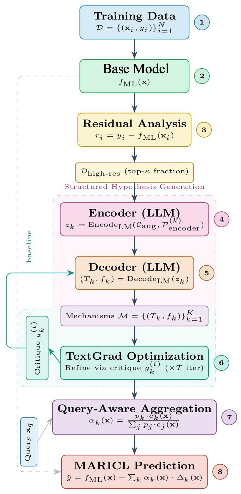

# MARICL — Multi-Agent Residual In-Context Learning

**Paper:** [From Residuals to Reasons: LLM-Guided Mechanism Hypotheses from Tabular Data](https://arxiv.org/abs/2605.22897)  
**arXiv:** [`2605.22897`](https://arxiv.org/abs/2605.22897) (v1 appeared under the earlier title *LLM-Guided Mechanism Inference from Tabular Data*)

---

## Abstract

> When software fails, we read the error, form a hypothesis, write a patch, and test it. When a tabular model fails, we usually retune it. Most interpretability methods report which features matter rather than how they combine. Asking an LLM to predict the target directly forces it to search the whole output space; instead, we anchor the prediction with a base model and ask the LLM to debug it. We introduce **Multi-Agent Residual In-Context Learning (MARICL)**, in which LLM agents read high-residual examples, hypothesize the missing structure, and write executable correction terms that are then refined by multi-turn textual gradient optimization. The resulting corrections are readable, executable hypotheses about what the base model misses, rather than validated mechanisms. Across nine benchmarks covering scientific, biomedical, socioeconomic, and synthetic data, MARICL reliably repairs its base model's structured residuals, improving it on every dataset, and it recovers the form of both nonlinear terms planted in a function absent from pretraining data (two seeds). Against the strongest competing baseline it leads on five of the eight real benchmarks and trails TabPFN on the other three, while adding an inspectable correction that black-box baselines do not provide.

---

## Overview



**(1–2)** A base ML model produces initial predictions. **(3)** Residual analysis selects high-error examples $\mathcal{D}_{\text{high-res}}$. **(4–5)** An LLM encoder produces structured hypotheses $z_k$; a decoder converts each into a natural-language explanation $T_k$ and an executable correction formula $f_k$. **(6)** Textual gradient optimization refines corrections through multi-turn critique feedback $g_k^{(t)}$. **(7–8)** Query-aware aggregation combines the base prediction with weighted corrections $\alpha_k(\mathbf{x})$.

**Prediction rule (regression):**

$$\hat{y}_{\text{MARICL}}(\mathbf{x}) = f_{\text{ML}}(\mathbf{x}) + \lambda(\mathbf{x}) \sum_{k=1}^{K} \alpha_k(\mathbf{x})\, f_k(\mathbf{x})$$

The weights $\alpha_k(\mathbf{x})$ decide which correction dominates at $\mathbf{x}$. The outer gate $\lambda(\mathbf{x}) \in [0,1]$ shrinks the summed correction, more strongly when no correction is both high-quality and close to the high-residual pool. Without the gate ($\lambda \equiv 1$), this is the rule that `MARICL.predict` applies.

At inference time, only the frozen formulas and nearest-neighbour lookups run — **zero LLM calls**.


## Repository contents

```
.
├── LICENSE                               # MIT
├── maricl_core.py                        # MARICL framework (sandbox, models, prompts, pipeline)
├── maricl_headline.py                    # Headline configuration: validation selection and outer gate
├── maricl_demo_v1.ipynb                  # Demo notebook (self-contained copy of the pipeline)
├── examples/
│   └── synthetic_claude/                 # Planted-ground-truth benchmark with Claude (replays offline)
└── MA_RICL_Discovery_V2/
    └── Figures/
        ├── figure1_maricl_schematic_v2.png
        └── results_figure.png
```

`maricl_core.py` contains everything that is not experiment-specific: the `ast`-sandboxed formula executor, Pydantic structured-output models (`Hypothesis`, `Correction`, `Critique`), encoder/decoder/critique prompts and functions, `CorrectionState`, and the `MARICL` class. To use it, call `maricl_core.configure_llms(llm, llm_creative)` once after initializing the LLM clients. The notebook carries its own copy of the pipeline, so it does not import this module.

`MARICL.predict` applies the ungated rule and keeps the iterate with the lowest training loss. For the paper's headline configuration on regression tasks, `maricl_headline.py` selects the retained iterate on validation data and applies the outer gate, with no further LLM calls:

```python
from maricl_headline import maricl_predict, select

chosen, scores, _ = select(model, X_train, y_train, X_val, y_val,
                           base.predict(X_train), base.predict(X_val))
y_hat = maricl_predict(model, X_test, base.predict(X_test), chosen, scores)
```

---

## Quickstart

### 1. Install dependencies

```bash
pip install langchain langchain-openai openai pydantic numpy scikit-learn matplotlib python-dotenv
```

### 2. Set your API key

Create a `.env` file in the project root:

```
OPENAI_API_KEY=sk-...
```

The notebook also accepts `API_KEY` as an alias. **Do not commit this file.**

### 3. Run the notebook

Open [`maricl_demo_v1.ipynb`](maricl_demo_v1.ipynb) and execute cells sequentially.

Optional environment overrides:

| Variable | Default | Description |
|---|---|---|
| `MAICL_MODEL_NAME` | `gpt-5.4-mini` | Model passed to LangChain/OpenAI |
| `OPENAI_REASONING_EFFORT` | `low` | Reasoning effort for GPT-5 family (`none` to disable) |

> Expect OpenAI API usage charges. Results vary slightly due to nonzero temperature.

---

## Synthetic demo scenarios

The notebook contains two self-contained experiments that require no external data.

### Experiment 1 — Synthetic regression

A linear base model is fit on a 4-feature dataset whose true generating process contains structure it cannot capture:

$$y = 0.5\,x_1 - 0.3\,x_2 + 0.2\,x_3 + 1.8\cdot\sigma(2\,x_1 x_2) + 0.4\,x_3^2 + \varepsilon, \quad \varepsilon \sim \mathcal{N}(0, 0.1)$$

The linear model fits only the first three linear terms; the **sigmoid interaction** ($x_1 \times x_2$) and the **quadratic term** ($x_3^2$) become residual signal. MARICL's encoder agents hypothesize these missing structures from the high-residual examples, the decoder compiles them into executable formulas, and textual gradient refinement iterates toward the true form.

**Setup:** 300 samples · 60/20/20 train/val/test split · `K=2` agents · `T=8` refinement steps

### Experiment 2 — Synthetic 3-class classification

A logistic regression base model is fit on a 4-feature dataset with a nonlinear decision boundary:

$$\text{class} = \begin{cases} 0 & x_1 x_2 < -0.5 \\ 2 & x_1 x_2 > +0.5 \\ 1 & \text{otherwise} \end{cases} \quad \text{(with } 0.5\,(x_3^2 - 1) \text{ perturbation and 2\% label noise)}$$

A logistic model captures only marginal effects and misses the interaction boundary. MARICL's correction agents discover the $x_1 \times x_2$ interaction and apply class-conditional correction probabilities.

**Setup:** 500 samples · 60/20/20 split · `K=3` agents · `T=8` refinement steps · `beta=0.3` · `kappa=0.4`

---

## Planted-ground-truth example with Claude

Did MARICL reason from the data, or just remember the domain? [`examples/synthetic_claude/`](examples/synthetic_claude/) tests this with a function that cannot appear in any LLM's pretraining data. Its prompts state that the features have unknown meaning, and Claude Opus 5.5 serves as the LLM.

| Test $R^2$ (mean of 2 seeds) | |
|---|---|
| Linear base | 0.370 |
| XGBoost | 0.787 |
| **MARICL** | **0.914** |
| MARICL without the outer gate | 0.958 |
| Oracle (noise-free) | 0.987 |

All four retained corrections contain both planted nonlinear terms as explicit components, and none uses the irrelevant feature. Recovery is not complete: the forms come back more faithfully than the constants, and only two of five started seeds finished.

Every prompt and answer is recorded, so the run replays with **no API key**:

```bash
cd examples/synthetic_claude
pip install -r requirements.txt
python agent_step.py --seed 0
python agent_step.py --seed 1
```

See the [example README](examples/synthetic_claude/README.md) for the full setup, its limits, and how to run it with your own Anthropic credentials.

---

## How it works

```
Base model → high-residual examples → Encoder agents (hypothesize) →
Decoder agents (compile to formulas) → Critique & refine (T rounds) →
Query-aware aggregation → Final prediction
```

Key design choices:
- **Residual targeting** — LLMs explain *what the base model misses*, not the full label.
- **Executable corrections** — Each $f_k$ is a sandboxed Python expression validated by `ast` at fit time. Inference needs only arithmetic and nearest-neighbour lookups.
- **Textual gradients** — Critique feedback ($g_k^{(t)}$) drives iterative refinement of both the explanation $T_k$ and formula $f_k$. The term is an analogy: no derivative is computed.
- **Query-aware aggregation** — $\alpha_k(\mathbf{x})$ decides which correction dominates at a query, and the outer gate $\lambda(\mathbf{x})$ shrinks the total correction when no correction is both high-quality and near the high-residual pool.
- **Hypotheses, not validated mechanisms** — Corrections are selected by residual-prediction performance and read against the literature afterwards. They need expert review before use in a new domain.

---

## Citation

```bibtex
@article{rezaei2026residuals,
  title={From Residuals to Reasons: LLM-Guided Mechanism Hypotheses from Tabular Data},
  author={Rezaei, Mohammad R and Krishnan, Rahul G},
  journal={arXiv preprint arXiv:2605.22897},
  year={2026}
}
```

---

## License

MIT. See [LICENSE](LICENSE).
