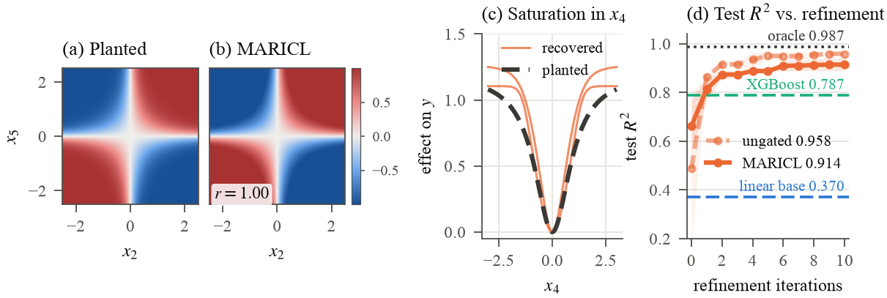

# Planted ground truth: can MARICL find a function it has never seen?

An LLM that improves a protein-yield model may simply remember its biochemistry. This example separates reasoning from recall. It plants a known function in synthetic data, tells Claude nothing about it, and checks what comes back.

$$y = 0.4\,x_1 - 0.3\,x_3 + 2\,\sigma(3\,x_2 x_5) + 1.2\,\frac{x_4^2}{1+x_4^2} + \varepsilon$$

Here $\mathbf{x} \sim \mathcal{N}(\mathbf{0}, I_6)$, $\varepsilon \sim \mathcal{N}(0, 0.1^2)$, and $N=1000$ (600/200/200 train/validation/test). Feature $x_6$ is irrelevant. Both nonlinear terms are uncorrelated with every individual feature, so a linear base model sees almost none of them. The prompts state that feature semantics are unknown.

This is the benchmark from Section 4.2 and Appendix E of the paper. MARICL runs with `K=2`, `T=10`, and Claude Opus 5.5 as the LLM. `maricl_core.py` at the repository root is used unmodified.

## Results

Test $R^2$:

| | Seed 0 | Seed 1 | Mean |
|---|---:|---:|---:|
| Linear base | 0.347 | 0.392 | 0.370 |
| XGBoost | 0.833 | 0.741 | 0.787 |
| **MARICL** (headline, gated) | **0.940** | **0.888** | **0.914** |
| MARICL (ungated) | 0.952 | 0.965 | 0.958 |
| Oracle (noise-free) | 0.986 | 0.987 | 0.987 |



This is one correction Claude wrote, retained on seed 0:

```python
clip(0.25 * x4**2 / (0.5 + x4**2) - 0.115 + 0.25 * tanh(1.5 * x2 * x5), -0.6, 0.6)
```

`tanh(1.5 * x2 * x5)` is the planted interaction's shape exactly, because $2\,\sigma(3u) = 1 + \tanh(1.5u)$. All four retained corrections contain an `x2 * x5` term and an even, saturating `x4` term, and none uses `x6`.

## What this does and does not show

- **Only two seeds.** Five seeds were started. Seeds 0 and 1 finished before the run was stopped for time and usage reasons, and no completed run was excluded. The partial records for seeds 2 to 4 are included in `bridge/`, but they have no results.
- **Forms, not constants.** Amplitudes and constants differ from the planted values. In raw `y` units the seed 0 interaction amplitude is 1.17 against the planted 1.0.
- **The gate costs accuracy here.** It lowers $R^2$ by 0.01 and 0.08 on the two seeds, because it shrinks every correction.
- **Agent sessions, not API calls.** A session keeps earlier requests in context, so calls within a seed are less independent than stateless API calls would be.
- **The prompts are not free of hints about the search space.** They contain generic illustrations (a product, a square, and a saturating ratio over `x1`, `x2`, `x3`). The planted terms sit on `x2 * x5` and `x4` so that none of these illustrations names them.
- **Hypotheses, not validated mechanisms.** Corrections are readable, executable hypotheses selected by residual-prediction performance. This benchmark tests the data-driven part of that process on a function with a known answer.

## Replay the recorded run (no API key)

The recorded answers replay through the released code with no LLM calls. This regenerates the base models, residuals, selection, and metrics, and it reproduces `results_agent/seed0.json` and `seed1.json` byte for byte.

```bash
cd examples/synthetic_claude
python -m venv .venv && source .venv/bin/activate
pip install -r requirements.txt

python agent_step.py --seed 0
python agent_step.py --seed 1
git status --short .          # empty: the results match what is committed

python make_synthetic_figure.py   # redraws synthetic_recovery.png and .pdf
```

Versions are pinned in `requirements.txt`. The replay was tested on Python 3.14, and the baselines can shift with other library versions.

## Run it yourself

**With the Anthropic API.** This calls Claude directly through `claude_backend.py`. It needs Anthropic credentials (for example `ANTHROPIC_API_KEY` in the environment or in a local `.env` file) and it incurs API charges.

```bash
python run_synthetic.py --seed 0        # writes results/seed0.json
```

The recorded results did not use this path, and answers are not seed-controlled, so expect your numbers to differ from the table above.

**Offline pipeline check.** This tests the plumbing only.

```bash
python run_synthetic.py --seed 0 --mock --T 3
```

The mock's answers have the planted form hard-coded, so its $R^2$ says nothing about Claude or MARICL.

## How the recorded run was produced

Claude Opus 5.5 served as the LLM through Claude Code agent sessions, with one fresh session per seed. `bridge.py` wrote each request (system prompt, user prompt, output schema) to a file, and the session returned one JSON answer through `agent_step.py`. The released code kept control of residuals, selection, scoring, and evaluation. Seeds 0 and 1 took 62 and 46 requests.

The sessions were not shown the generating function, and they were instructed to run no code, read no other files, and answer each request from its own content. Appendix E of the paper gives the full protocol.

To answer requests with your own agent, run `python agent_step.py --seed S` to print the next request, then pipe one JSON answer back into the same command. `run_synthetic.py` contains the planted formula, so keep the answering agent away from that file.

## Files

| Path | Purpose |
|---|---|
| `run_synthetic.py` | Benchmark definition, selection, metrics, and the API and mock entry points |
| `agent_step.py` | One step of an agent-answered run, and the replay command |
| `bridge.py` | File-based bridge that records requests and replays answers |
| `claude_backend.py` | Anthropic SDK adapter that lets `maricl_core.py` run unmodified |
| `make_synthetic_figure.py` | Redraws the figure from stored results, with no fitting |
| `bridge/seed*/` | Every recorded request and answer, plus fit logs |
| `results_agent/` | Results for the two finished seeds |
