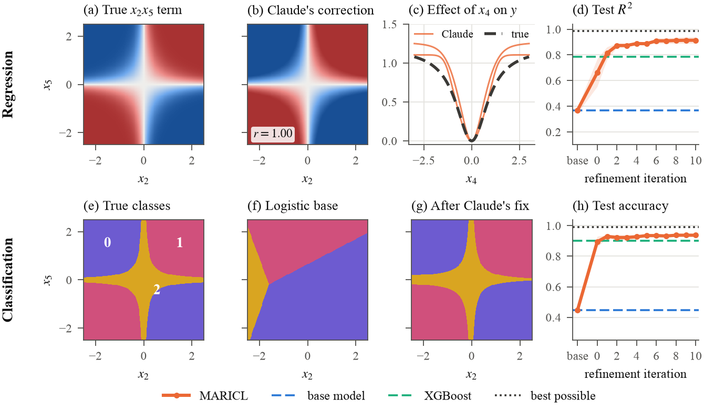

# Examples on synthetic data

A simple base model is fit to data with structure it cannot represent. Claude Opus 5.5 then reads the examples where the base model is most wrong and writes a formula that fixes those residuals. The prompts give Claude no hints: every feature is described as having unknown meaning.



| | Task | Base model | XGBoost | **MARICL** | Best possible |
|---|---|---:|---:|---:|---:|
| Regression | test R² | 0.370 | 0.787 | **0.914** | 0.987 |
| Classification | test accuracy | 0.448 | 0.900 | **0.938** | 0.990 |

Means over two seeds. Per-seed numbers are in `results/`. Both tasks are in Section 4.2 and Appendix E of the paper, and the figure is its Figure 1.

## Regression

$$y = 0.4\,x_1 - 0.3\,x_3 + 2\,\sigma(3\,x_2 x_5) + 1.2\,\frac{x_4^2}{1+x_4^2} + \varepsilon$$

A linear base model captures the $x_1$ and $x_3$ terms but misses the other two. Claude's correction on seed 0:

```python
clip(0.25 * x4**2 / (0.5 + x4**2) - 0.115 + 0.25 * tanh(1.5 * x2 * x5), -0.6, 0.6)
```

`tanh(1.5 * x2 * x5)` has exactly the true shape, since $2\,\sigma(3u) = 1 + \tanh(1.5u)$.

## Classification

Each point belongs to the class with the largest score (2% of labels are resampled at random):

$$s_0 = -2\,x_2 x_5, \qquad s_1 = 2\,x_2 x_5, \qquad s_2 = 1.5\,(x_4^2 - 1) + 0.8\,x_1 - 0.6\,x_3 + 0.5$$

A logistic base model cannot represent the $x_2 x_5$ interaction or the even $x_4$ term. Claude's correction on seed 0, one score shift per class:

```python
[clip(-4.5*x2*x5, -8.0, 8.0), clip(4.5*x2*x5, -8.0, 8.0), clip(2.5*x4**2 - 0.75, -2.0, 8.0)]
```

## Run it

Every prompt and answer is recorded, so both examples replay **with no API key** and reproduce `results/` exactly:

```bash
pip install -r requirements.txt

python agent_step.py --task regression --seed 0
python agent_step.py --task classification --seed 0
python make_figure.py                     # wide figure, as above
python make_figure.py --layout vertical   # one-column version, Figure 1 of the paper
```

To call Claude yourself, set `ANTHROPIC_API_KEY` and run `python regression.py --seed 0` or `python classification.py --seed 0`. This costs API credits, and the results will differ from the recorded ones.

To have a Claude Code agent answer the requests instead, as in the recorded runs, give it the prompt in [`agent_prompt.md`](agent_prompt.md).

## Files

| Path | What it is |
|---|---|
| `regression.py`, `classification.py` | The two examples |
| `agent_step.py`, `bridge.py` | Replay recorded answers, or answer new requests one at a time |
| `claude_backend.py` | Lets `maricl_core.py` call Claude through the Anthropic SDK |
| `make_figure.py` | Redraws the figure from `results/`, wide or one column (`--layout vertical`) |
| `agent_prompt.md` | The prompt given to each Claude Code session that answered the requests |
| `recorded_answers/` | Every request and answer |
| `results/` | Results for each seed |
